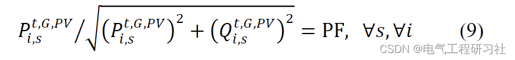
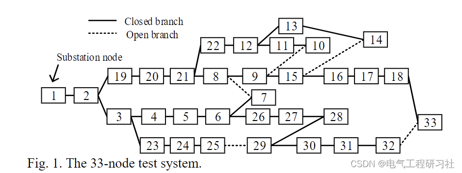
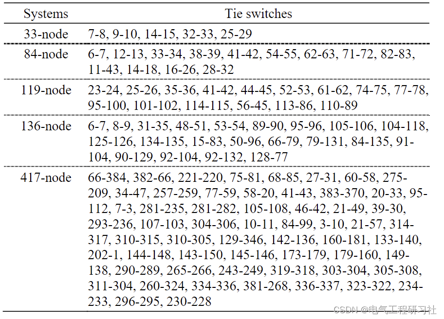
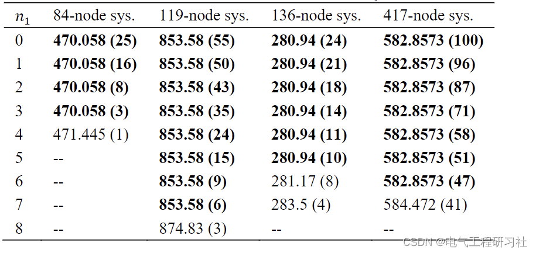
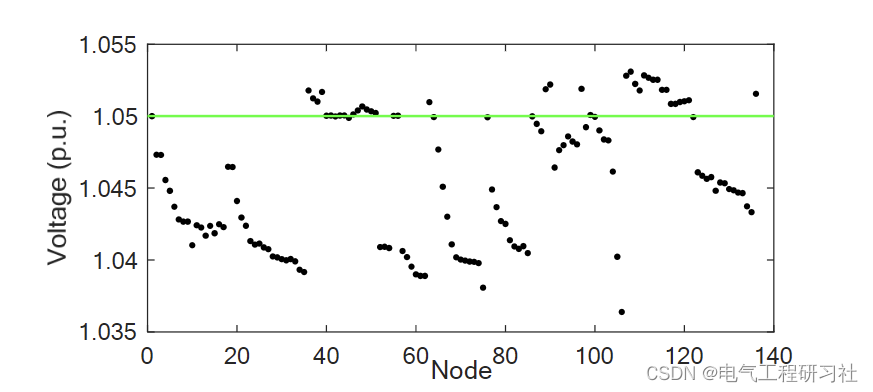
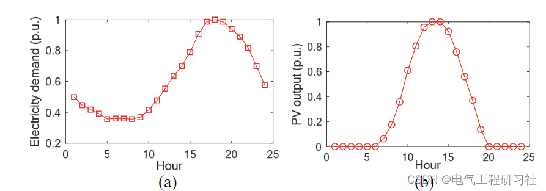
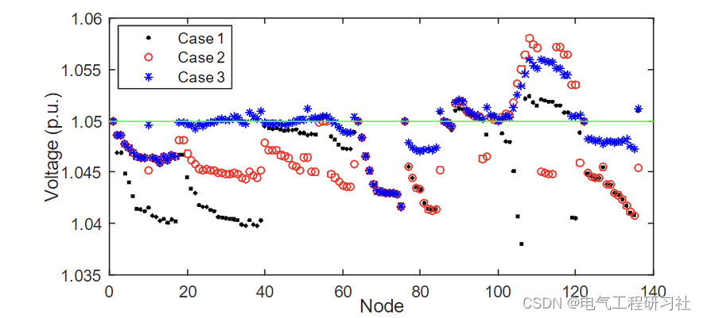
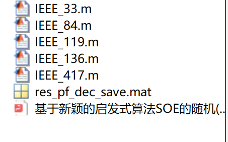

# Reconfiguration of Power Distribution Network | Random (SDNR) Reconfiguration of Power Distribution Network Based on Novel Heuristic Algorithm SOE (Matlab Code Implementation)

Power Distribution Network Reconfiguration | Random (SDNR) Power Distribution Network Reconfiguration Based on a Novel Heuristic Algorithm SOE (MATLAB Code Implementation) [Case Studies: 33-node, 84-node, 119-node, 136-node, 417-node]
Keywords: Power Distribution Network Reconfiguration, SOE Algorithm, Multi-period Random Reconfiguration
Simulation platform: MATLAB + CPLEX/gurobi platform
Advantages: The code is of certain depth and innovativeness, with clear comments, not commonplace code, very high quality!
Main Content: The main task of the code is to obtain the optimal network topology through power distribution network reconfiguration, thereby effectively reducing network losses and improving economic benefits. It also considers the randomness of photovoltaics and loads, constructing a multi-period random power distribution network reconfiguration model. Considering the large network calculation is time-consuming, an SOE method based on breakage and exchange was adopted, which has achieved good radial topology. IEEE multiple standard case studies were used for testing, which are more innovative and have solved the problem better. The results are basically consistent with literature.
1. Overview of Power Distribution Network Reconfiguration (DNR)
The objective of DNR is to determine the optimal topology of the power distribution network, which is an effective measure to reduce power loss in the network. The demand for electricity load and photovoltaic (PV) output are uncertain and vary with time throughout the day, affecting the optimal network topology. Single-hour deterministic DNR cannot handle this uncertainty and variability. Therefore, this paper proposes a solution for multi-hour stochastic DNR (SDNR). Existing DNR solutions either lack accuracy or are too time-consuming, thus failing to address large power distribution networks' SDNR over several hours. In this regard, a Switch Off and Exchange (SOE) method is proposed. SOE starts from a ring network with all switches closed, comprising three steps. The first step involves opening switches one by one until all loops are open. The second and third steps modify the branch states obtained in the first step to achieve a better radial topology. Five test systems are used to verify the accuracy and rapid solution speed of SOE, as well as its superiority over single-hour deterministic DNR in terms of minimizing energy loss and reducing the number of switch operations.
The structure of this paper is as follows: 1) A novel heuristic algorithm, namely SOE, is proposed that outperforms other heuristic algorithms, EA, and MP in terms of accuracy or solving speed; this is the main contribution of this paper, 2) It is validated for the first time that a solution can be obtained for multi-hour SDNR, achieving a good compromise between minimizing energy loss and reducing the number of switch operations, and it is superior to single-hour DNR and DDNR. Considering that existing methods are insufficient to solve multi-hour SDNR, especially for large systems, SOE advances the frontier of complex DNR solutions. The remainder of this paper is arranged as follows. Section 2 presents the model for multi-hour SDNR. The details of the SOE method are elaborated in Section 3. Section 4 provides simulation results and Matlab code. The conclusions are presented in Section 5.
Mathematical Model
Detailed mathematical models are described in Part 4.
Run Results
The results are presented in Section 6.
Editor
Editor
Editor
4 Matlab Code and Article Details
This article only displays a portion of the code, all codes can be found in:

## Images

<!-- PAYMENT_BLOCK -->

## Get this dataset

- Payment link (Stripe): [Buy now](https://buy.stripe.com/3cs8yP7sY87d0vu9AB)
- Payment QR code: 

<!-- /PAYMENT_BLOCK -->
